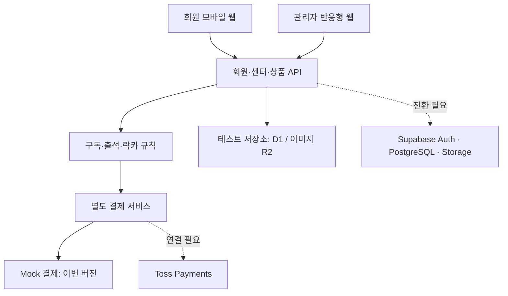

# ANY BOXING 센터 관리 — 아키텍처와 구현 상태

## 이번 버전

관리자 웹과 회원 모바일 웹을 갖춘 **비공개 기능 테스트 버전**입니다. 실서비스가 연결된 상태가 아닙니다. 실제 회원 정보는 넣지 않습니다.

- 지점별 센터 생성·수정·운영 중단
- 상품 생성·가격·월 구독/일회성·판매 정원·재고·판매 중단·정렬·이용 가능 지점
- 상품 이미지 업로드·교체·연결 해제
- 센터별 모바일 첫 화면 배경색·배경 이미지·문구·이미지 어둡기·저장 전 미리보기
- 가상 회원, 모의 결제, 구독 생성, 기간 종료 해지, 이용 정지/재개
- 일일 중복 출석·회원권 상태·센터·주간 이용 횟수 확인 및 거부 사유 저장
- 락카 선택 구매·관리자 위치 변경·변경 이력
- 일회성 상품 구매·재고 차감, 가격 변경 이력, 대시보드
- 서버 영구 저장. 브라우저 저장소에 운영 데이터를 보관하지 않습니다.

## 구성

회원용 `/member`와 관리자 `/`를 분리했습니다. 웹 프런트는 React, API는 별도 경로입니다. 실제 서비스는 Supabase JWT를 검증하는 API/Edge Functions로 교체하고 같은 업무 흐름을 사용합니다. 모바일 웹 이후 PWA/Flutter에서도 이 API를 재사용합니다.

현재 로그인은 비공개 미리보기를 위한 사이트 소유자 인증입니다. 화면에서 고르는 가상 회원은 실제 로그인이나 본인인증이 아닙니다. 사이트 소유자별 테스트 데이터가 분리됩니다. 실제 회원에게 이 테스트 사이트를 운영용으로 공개하지 않습니다.

## 데이터 구조

운영용 PostgreSQL 설계는 `supabase/migrations/202609290001_initial.sql`에 있습니다. 로컬 PostgreSQL 엔진에서 40개 검사를 통과했습니다. 사용자 Supabase 프로젝트에는 아직 적용하지 않았습니다. 실행용 SQL과 확인 SQL은 supabase/setup에 있습니다.

| 영역 | 테이블 | 핵심 관계 |
|---|---|---|
| 사용자 | profiles, center_members, center_admins | Auth 사용자와 회원 프로필, 지점별 권한 분리 |
| 센터 | centers, center_appearance | 지점과 배경색·배경 이미지·문구 1:1 |
| 상품 | products, product_prices, product_access_centers | 상품·불변 가격 이력·이용 가능 센터 분리 |
| 이미지 | media_assets | 업로드한 객체 경로·센터·작성자; 상품과 배경이 참조 |
| 구독 | subscriptions, subscription_items, subscription_access_centers | 구매 당시 금액 및 이용 정책 스냅샷 |
| 결제 | payment_configs, payments, payment_attempts | 센터별 PG 설정과 결제 이력·중복 요청 방지 |
| 주문 | orders, order_items | 상품·수량·구매 가격 스냅샷 |
| 출석 | attendance | 성공/거부, 사유, 한국 날짜, 회원·지점·회원권 |
| 락카 | lockers, locker_assignments, locker_changes | 락카 실물·기간별 배정·변경 이력 분리 |

운영용 결제 계정 비밀값과 빌링키는 공개 테이블에 저장하지 않습니다. 비공개 스키마의 계정 참조와 서버 비밀 저장소를 사용하도록 분리했습니다.

테스트 저장소의 JSON + 버전 비교 저장 방식은 소규모 기능 확인용입니다. 실서비스 PostgreSQL 관계형 DB를 대체하지 않습니다. 동시 테스트 요청은 비교 후 저장 방식으로 충돌을 감지하고 재시도합니다.

## 규칙

- 이용 종료일은 제외됩니다. 예를 들어 10월 1일 시작, 11월 1일 종료는 10월 31일까지 이용 가능합니다.
- 시간 표시는 한국 시간, 주간 출석은 월요일부터 일요일입니다.
- 취소 요청은 `CANCEL_AT_PERIOD_END`로 바뀌고 기간이 끝날 때까지 이용할 수 있습니다.
- 정지된 구독도 정원과 락카를 유지합니다. 새 구독으로 정원을 우회하지 못합니다.
- 가격 변경은 이후 신규 구매에만 적용됩니다.
- 결제 성공 전 회원권·락카를 생성하지 않습니다. 중복 결제 요청은 같은 식별자로 재처리하지 않습니다.
- 업로드는 JPEG/PNG/WebP, 최대 5MB입니다. 서버에서 파일 시그니처와 크기를 확인합니다.
- 이미지 삭제 버튼은 상품/배경에서 연결을 해제합니다. 저장소의 미사용 원본 정리 기능은 후속 작업입니다.

## 남은 운영 연결 작업

1. Supabase 프로젝트 생성 또는 기존 프로젝트 확인, 마이그레이션 적용, 실제 DB 기반 저장소 어댑터 구현 및 RLS 검증.
2. 이름·휴대폰 프로필과 실제 로그인 연결. 이름과 휴대폰 입력만으로 본인 인증이 되지는 않으므로 휴대폰 OTP 공급자 또는 승인된 OAuth 설정 필요.
3. Supabase Storage 업로드 연결과 관리자별 센터 권한 검증.
4. Toss 빌링 인증, 최초 승인, 서버 스케줄 재결제, 웹훅 검증, 실패 재시도, 대사·환불 구현.
5. QR 생성·배포와 실제 인증된 회원 출석 연결.
6. 실데이터 백업·보존 정책, 관리자 초대·권한 관리, 실서비스 통합 테스트.

준비된 SQL은 RLS와 기본 제약을 포함하지만, 결제/주문/배정의 운영용 트랜잭션은 아직 구현되지 않았습니다. 테스트 API를 실서비스 API라고 간주하면 안 됩니다.

## 연결에 필요한 정보

- Supabase 프로젝트 URL 및 publishable/public key. 서비스 키는 서버 비밀 설정에만 입력.
- 회원 로그인 방식에 필요한 공급자 설정 (예: 휴대폰 OTP).
- 센터별 Toss 정기결제 계약, 테스트 Client Key, 테스트 Secret Key, 상점 식별 정보.
- 실제 회원 웹 도메인과 승인/실패 callback URL.

Secret Key를 채팅이나 공개 화면에 붙여넣지 말고, 연결 단계에서 해당 서비스의 비밀 설정에 넣습니다.

공식 참고: [Supabase RLS](https://supabase.com/docs/guides/database/postgres/row-level-security), [Storage 접근 제어](https://supabase.com/docs/guides/storage/security/access-control).

